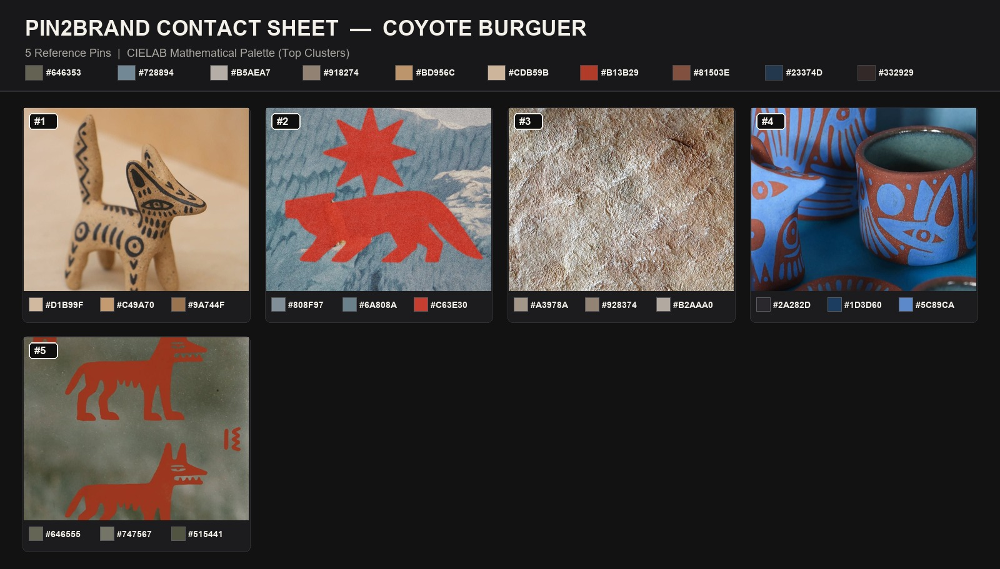

# Pin2Brand

> **Turn any Pinterest board (or local moodboard folder) into an Agent-Ready Visual Identity Kit.**
> Stop AI coding agents from defaulting to generic indigo SaaS templates.

[](LICENSE)
[](pyproject.toml)
[](src/pin2brand/mcp_server.py)
[](src/pin2brand/exporter.py)



---

## Why Pin2Brand?

When you ask an AI coding agent (**Antigravity, Cursor, Claude Code, Windsurf, Bolt, v0**) to build an app or landing page without strict visual tokens, it almost always outputs the same purple/indigo Tailwind layout. Meanwhile, your real visual inspiration lives on **Pinterest** or in a folder of saved images.

**Pin2Brand** bridges that gap:
1. **Scrapes** any public Pinterest board (via internal `BoardResource`/`BoardFeedResource` API, RSS upgrade, or HTML hydration) — or ingests any **local image folder**.
2. **Computes deterministic Color & Texture Math**: Runs **K-Means clustering in perceptual CIELAB (`L*a*b*`) space**, measures **2D Laplacian surface grain** and **earth-tone balance**, and verifies **WCAG 2.1 contrast ratios**.
3. **Generates a Dynamic Contact Sheet (`contact_sheet.jpg`)**: A numbered 4-column visual reference grid (`#1..#N`) with per-pin HEX swatches.
4. **Synthesizes Art Direction**: Supports **Gemini Vision**, **OpenAI (`gpt-4o`)**, **Local Ollama (`llama3.2-vision` / `qwen2.5-vl`)**, or a **100% free deterministic offline synthesizer**.
5. **Exports 11 Multi-Agent & Design Artifacts** ready to drop into your repo, Figma, or image generator.

---

## Quick Start

### 1. Run with `uv` (Local Clone)

```bash
git clone https://github.com/jonaduran13-creator/pin2brand.git
cd pin2brand
uv sync

# Analyze a public Pinterest board:
uv run pin2brand analyze "https://mx.pinterest.com/jonathanduransandoval/coyote-burguer/"

# Or analyze a local folder of moodboard images:
uv run pin2brand analyze ./my-inspiration-folder
```

### 2. Run in One Command via `uvx` (Zero Install)

```bash
uvx --from git+https://github.com/jonaduran13-creator/pin2brand pin2brand analyze "https://mx.pinterest.com/jonathanduransandoval/coyote-burguer/"
```

---

## 11 Exported Multi-Agent Artifacts

Every run creates `output/<board-slug>/` with:

| File | Target Audience / Tool | Purpose |
| :--- | :--- | :--- |
| **`visual-identity.json`** | Scripts, SDKs, Custom Agents | Master Pydantic-validated JSON schema (colors, fonts, UI rules, prompts, pin tags) |
| **`AGENTS.md`** | **Antigravity, Claude Code, Codex** | Drop into your project root so coding agents obey your brand tokens & anti-patterns |
| **`cursor-visual-identity.mdc`** | **Cursor IDE** | Drop into `.cursor/rules/` (`alwaysApply: true`, front-end file globs pre-configured) |
| **`SKILL.md`** | **Agent Skills** | Installable agent skill with YAML frontmatter (`<slug>-visual-identity`) |
| **`DESIGN_SYSTEM.md`** | Humans & Coding Agents | Complete Markdown design system specification |
| **`tokens.w3c.json`** | **Figma (Tokens Studio) & Style Dictionary** | Official W3C Design Tokens Community Group (`$value`, `$type`) format |
| **`tokens.css`** | Front-End Apps (CSS / Vite / Next.js) | Native `:root` CSS Custom Properties (`--brand-bg-primary`, `--brand-shadow`, etc.) |
| **`tailwind.theme.json`** | Tailwind CSS | Theme extension object for `tailwind.config.js` |
| **`generative-prompts.json`** | **Midjourney, Flux, Imagen / Nano Banana** | Ready-to-paste `/imagine` commands, negative prompts, and local `--sref` paths |
| **`brand-preview.html`** | Interactive Browser Studio | Live UI Playground with **"Before (Generic SaaS) vs After (Pin2Brand)" toggle**, live color pickers, and JSON re-export |
| **`contact_sheet.jpg`** | Multimodal Vision LLMs & Art Directors | Dynamic-height numbered moodboard mosaic with global and per-pin CIELAB swatches |

---

## Connect as an MCP Server (Antigravity / Claude Desktop / Cursor)

Add `pin2brand-mcp` to your `mcp_config.json` / `claude_desktop_config.json`:

```json
{
  "mcpServers": {
    "pin2brand": {
      "command": "uv",
      "args": [
        "--directory",
        "C:/path/to/pin2brand",
        "run",
        "pin2brand-mcp"
      ]
    }
  }
}
```

Then ask your agent:
> *"Call `extract_pinterest_visual_identity` on `https://mx.pinterest.com/jonathanduransandoval/coyote-burguer/` and build our landing page using those exact tokens."*

---

## Vision Providers (`--provider`)

Pin2Brand works **out of the box with zero API keys** using its CIELAB + Laplacian texture heuristic engine, and upgrades automatically when a Vision LLM is available:

```bash
# Auto-detect (uses GEMINI_API_KEY -> OPENAI_API_KEY -> deterministic heuristic)
uv run pin2brand analyze "<url>" --provider auto

# Google Gemini Vision
export GEMINI_API_KEY="your-key"
uv run pin2brand analyze "<url>" --provider gemini --model gemini-2.5-flash

# OpenAI Vision
export OPENAI_API_KEY="your-key"
uv run pin2brand analyze "<url>" --provider openai --model gpt-4o

# 100% Free Local Vision via Ollama
uv run pin2brand analyze "<url>" --provider ollama --model llama3.2-vision

# Deterministic Offline Math Engine
uv run pin2brand analyze "<url>" --offline
```

### Private / Secret Pinterest Boards

If your Pinterest profile or board is private, pass an exported `cookies.json` / `cookies.txt` or set `PINTEREST_SESSION_COOKIE`:

```bash
uv run pin2brand analyze "<private-board-url>" --cookies cookies.json
```

---

## Running Tests

```bash
uv sync --extra dev
uv run pytest -v
```

## License

Released under the [MIT License](LICENSE).
